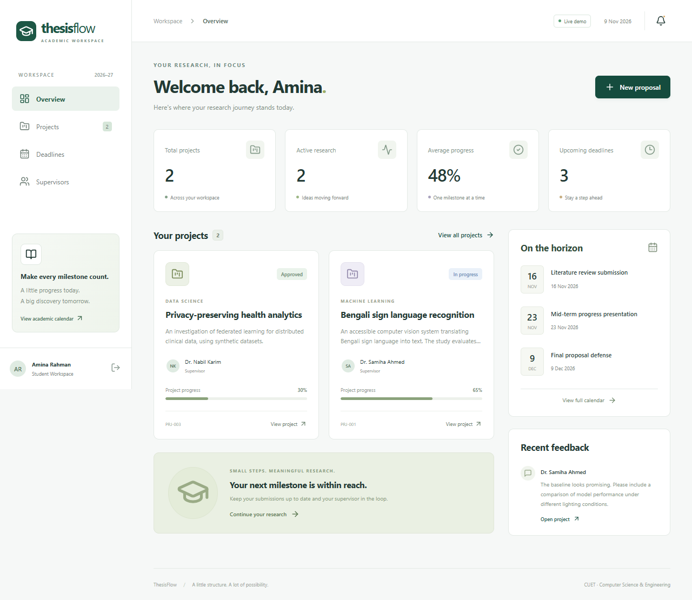

# ThesisFlow — Thesis & Project Management Portal

[Live demo](https://thesisflow-wine.vercel.app) · [GitHub Actions](https://github.com/faoziafariha/ThesisFlow/actions) 


A full-stack academic workspace with a React/TypeScript interface, an Express REST API, SQLite locally and persistent PostgreSQL storage on Vercel, and a Docker-to-GitHub-Actions delivery pipeline.

Built as a portfolio extension of the supplied **CUET Thesis & Project Portal**. Original contributors: **Faozia Fariha, Arpita Mallik, and Ratnajit Dhar**. See [provenance](docs/PROVENANCE.md) for the distinction between the academic source and this implementation.



## Try it locally

Install **Node.js 24** and run from this folder:

```sh
npm ci
npm run dev
```

Open **http://localhost:5173**. Choose **Student**, **Supervisor**, or **Admin** on the sign-in page. These are real server sessions for seeded demonstration users. Changes persist in `data/portal.sqlite`.

Alternatively, use Docker Desktop with its Linux engine running:

```sh
docker compose up --build -d
```

Open **http://localhost:3000**. `docker compose down` preserves the database volume. `docker compose down -v` deletes the demo data permanently.

## What works

| Role | Workflow |
| --- | --- |
| Student | Create proposals, choose approved supervisors, search/filter projects, update progress after approval, upload PDFs, download prior document versions, read supervisor feedback and notifications |
| Supervisor | See assigned projects, review proposals and submissions, send feedback, approve/request changes/complete projects |
| Admin | Inspect all projects, approve seeded pending accounts, create academic deadlines, inspect the audit trail |
| Everyone | Dashboard, academic calendar, supervisor directory, session login/logout, responsive navigation |

Demo login is also available with these accounts and password `DemoPass!2026`:

- `student@demo.thesisflow.app`
- `supervisor@demo.thesisflow.app`
- `admin@demo.thesisflow.app`

`DEMO_MODE=false` hides and disables one-click demo access. In production this also requires `SEED_PASSWORD`. The seed password only applies when creating a fresh database; changing the environment does not rotate existing passwords. There is no public registration, account invitation or password reset in this portfolio version. Account approvals demonstrate the workflow using a seeded pending user.

## Engineering and delivery

- TypeScript type checks and Vite production build
- Asynchronous Express API with validated inputs and parameterized SQL
- Scrypt password hashes, opaque server sessions, HttpOnly cookies, same-site cookies, origin checks, rate limits and Helmet headers
- Server-enforced role and project ownership checks; protected document downloads
- SQLite WAL and a persistent Docker volume locally; pooled PostgreSQL with transactional initialization on Vercel
- Multi-stage Docker image running as a non-root user, health checks and graceful shutdown
- API integration tests and Playwright browser workflows
- GitHub Actions: build → API tests → browser tests → Docker build → container smoke test → vulnerability scan → publish to GHCR → optional VPS deploy
- Caddy automatic HTTPS for a domain on a VPS; health-check failure rolls back to the previous image when one exists


## Quality checks

```sh
npm run build
npm test
npx playwright install chromium
npm run test:e2e
```

API tests cover authentication, pending accounts, role scope, ownership, proposal/review/progress flows, PDF validation and version history, admin actions, origin rejection, logout, and disabling demo access. Browser tests cover all three role workflows plus mobile navigation and search. They use an isolated in-memory database, never your local database.

## GitHub repository and Vercel

Target repository: [faoziafariha/ThesisFlow](https://github.com/faoziafariha/ThesisFlow).

For Vercel, read [VERCEL.md](docs/VERCEL.md) before importing. The full app can run on Vercel with a connected Neon Free PostgreSQL database; local Docker runs can retain SQLite.


## Scope and tradeoffs

This is a single-instance portfolio application, not a horizontally scalable university production service. PDF files are capped at 2 MB and stored as database BLOBs. Demo users share mutable data. Use fictional content, back up the database, and reset demo data periodically. A real institutional deployment needs account lifecycle management, separate organizations, malware scanning, operational monitoring, audit retention, accessibility auditing, and a managed database/object store at larger scale. Document uploads preserve versions; there is no document editor or real-time chat. Academic deadlines are global rather than project-specific.

## Attribution and rights

The supplied archive did not include a license. Original authors retain their rights; no license is invented here. Confirm permission to publish the retained academic source/report, keep contributor credits, and describe your extension accurately. Credential-like JSON files, generated test results and accidental files from the archive were excluded.
