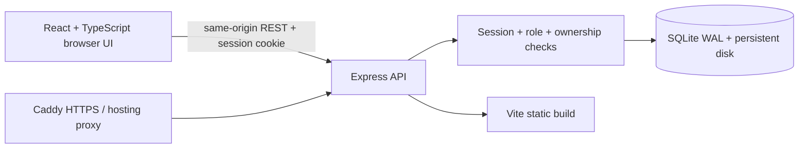
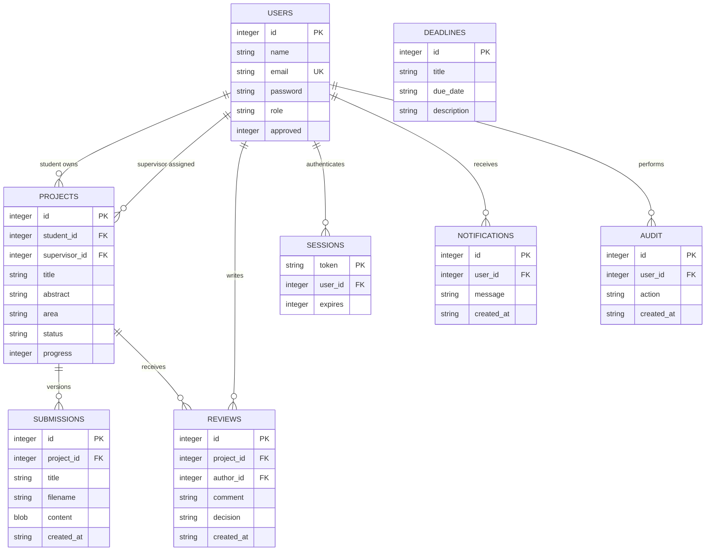

# Architecture and design

## Runtime

In development, Vite proxies `/api` to port 3000. In production, Express serves both the built UI and API on the same origin. The container is one deployable service; the VPS adds Caddy as an HTTPS reverse proxy.

`src/App.tsx` contains the small workspace UI and typed API state. `server/app.js` creates the HTTP application, validates requests, enforces permissions and implements domain routes. `server/db.js` defines the initial schema, demo seed and password hashing. `server/index.js` wires configuration, process lifecycle and persistent storage. SQL is parameterized. Tests instantiate the application with an isolated database. The original frontend is archived and excluded from builds and Docker images.

## Data model

Global deadlines apply to the workspace. PDF submissions are append-only document versions ordered by submission ID. The schema initializes idempotently and records `PRAGMA user_version=1`; this is an initial schema, not a general migration system. Subsequent schema changes need numbered, tested migrations.

## Authorization

| Action | Student | Supervisor | Admin |
| --- | --- | --- | --- |
| Read projects, reviews, documents | Own | Assigned | All |
| Create proposal | Yes | No | No |
| Update progress | Own approved/in-progress project | No | No |
| Upload document | Own | No | No |
| Review/decide | No | Assigned | No |
| Create global deadline | No | No | Yes |
| Approve account, read audit | No | No | Yes |

Proposal state starts at `Proposed`. The assigned supervisor can set `Approved`, `Changes requested`, `In progress`, or `Completed`. A student progress update is allowed only for approved/in-progress work and moves it to `In progress`. Completing a project sets progress to 100. Supervisors can reopen work with a later decision; strict one-way academic state transitions are intentionally outside this version.

## Security and operational limits

Passwords use per-password random salts and scrypt. Sessions use random 256-bit opaque values; the database stores SHA-256 digests rather than raw cookie values. Sessions expire after eight hours and are revoked on logout. Pending accounts cannot use existing sessions. Production cookies use Secure, HttpOnly and SameSite=Lax. Mutation requests reject foreign browser origins. Authentication and API requests are rate-limited; the limits are per process and not distributed.

Protected document downloads always use attachment disposition. A PDF signature and size are checked, but this is not malware scanning. Store synthetic content in the demo. Errors shown to clients omit stack traces. TLS is handled by the hosting platform/Caddy. Production trusts one reverse-proxy hop; re-evaluate if changing the topology.

SQLite suits a modest, single-instance demonstration. Larger deployment should move to PostgreSQL, object storage, asynchronous scanning, shared rate limits, centralized sessions/identity, monitored migrations and background notifications. Container rollback cannot reverse data migrations. Retention/cleanup of demo records and audit rows is manual in this version.
